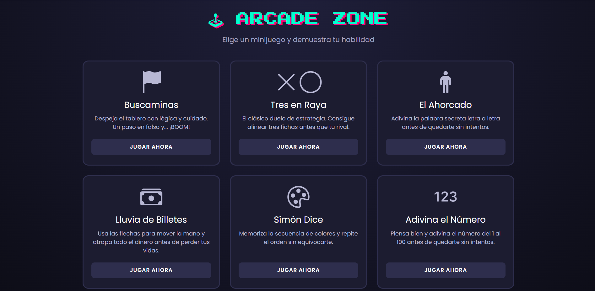
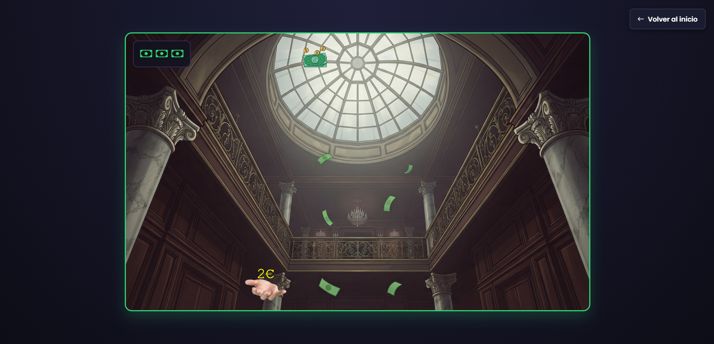
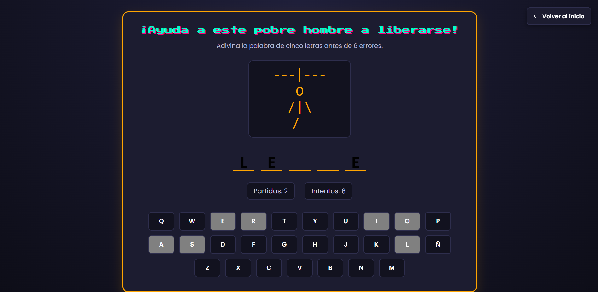
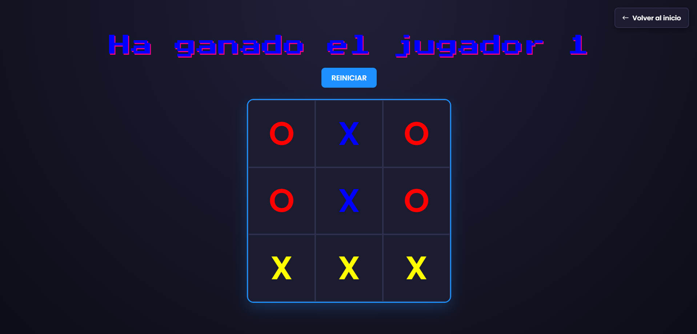
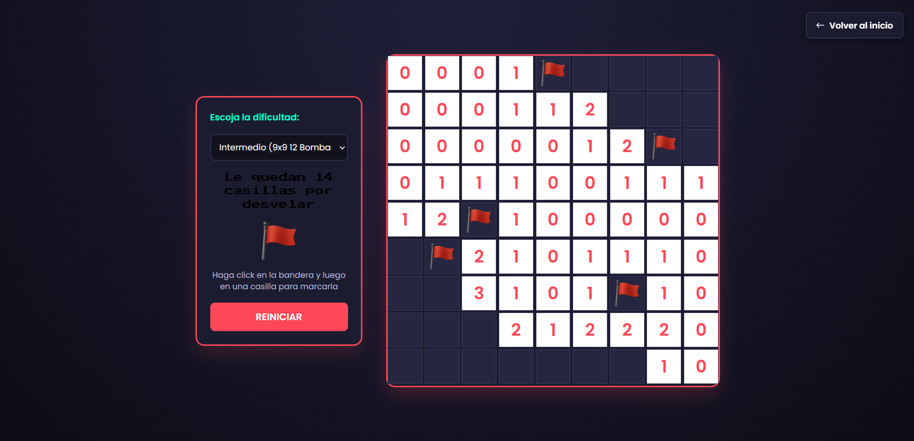
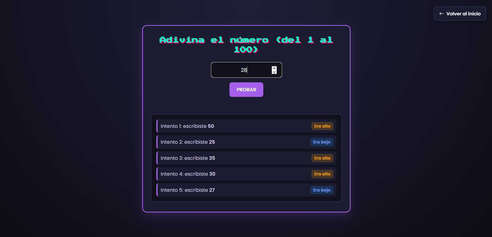
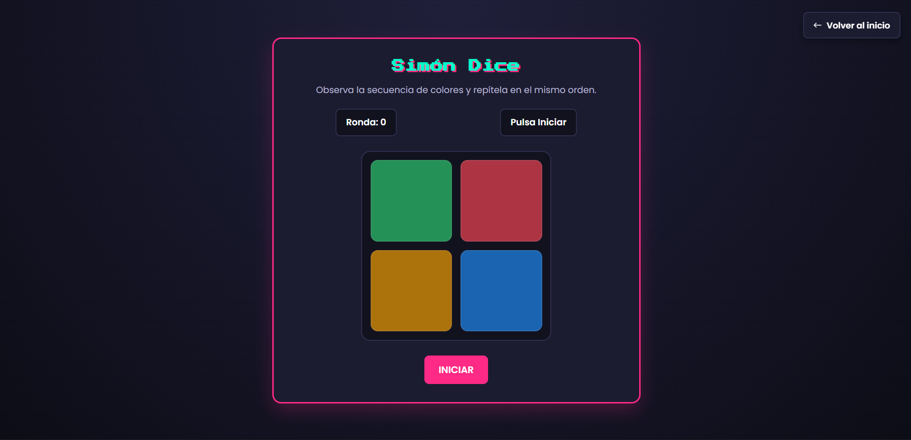

Zona Arcade es una aplicación web personal con estética arcade oscura y neón que reúne seis minijuegos clásicos desarrollados con tecnologías web estándar.

## Capturas de pantalla

## Funcionalidades y minijuegos

1. **Menú principal unificado:** Portada estilo salón recreativo con tarjetas interactivas diferenciadas por color para acceder rápidamente a cada juego.
2. **Navegación persistente:** Botón fijo de "Volver al inicio" presente en todos los minijuegos para regresar al menú principal en cualquier momento.
3. **Lluvia de Billetes:** Minijuego en 2D en el que debes mover una mano de izquierda a derecha con las flechas del teclado para recoger los billetes que caen antes de que toquen el suelo, con límite de fallos.
4. **El Ahorcado:** Juego clásico de palabras de cinco letras con teclado interactivo en pantalla, contador de partidas e intentos y dibujo progresivo del personaje hasta un máximo de 6 errores.
5. **Tres en Raya:** Partida clásica para dos jugadores por turnos en un tablero de 3x3 con detección automática de ganador o empate y opción de reinicio rápido.
6. **Buscaminas:** Tablero configurable en tres niveles de dificultad (Fácil 6x6 con 5 bombas, Intermedio 9x9 con 12 bombas y Difícil 12x12 con 23 bombas), con sistema para marcar casillas con bandera.
7. **Adivina el Número:** Juego de lógica en el que debes acertar un número secreto entre 1 y 100 eligiendo la dificultad (5, 7 o 10 intentos), con historial visual de intentos y pistas de si el número introducido es alto o bajo.
8. **Simón Dice:** Juego de memoria visual donde debes observar una secuencia creciente de cuatro colores e ir repitiéndola en el orden exacto ronda tras ronda.

## Configuración

Este proyecto es completamente frontend y no requiere servidor backend ni base de datos.

1. Clonar o descargar el repositorio en tu equipo.
2. Abrir el archivo `index.html` directamente en cualquier navegador web moderno (Chrome, Firefox, Edge, etc.).
3. *(Opcional)* Si quieres evitar posibles restricciones con rutas o imágenes en algún navegador, puedes abrir la carpeta del proyecto usando una extensión como **Live Server** en Visual Studio Code o cualquier servidor local sencillo.

## Tecnologías utilizadas

- HTML5
- CSS3 (Flexbox y CSS Grid)
- JavaScript (Vanilla JS)
- Bootstrap Icons
- Google Fonts (*Press Start 2P* y *Poppins*)

## Datos

Autor: Isaac Espinosa Acevedo.  
Correo electrónico: isaacespi96@gmail.com  

Este proyecto es de uso personal y educativo. Totalmente realizado a mano, sin código proporcionado por ninguna inteligencia artificial excepto la imagen de fondo del minijuego "Lluvia de billetes", solo como herramienta. Todos los derechos reservados.
